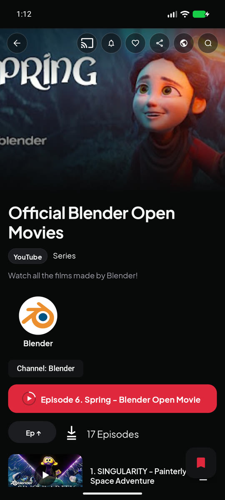
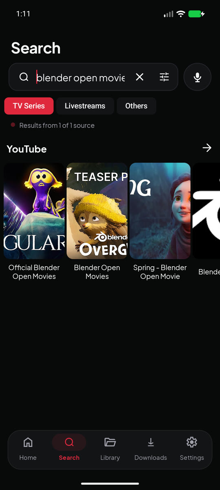
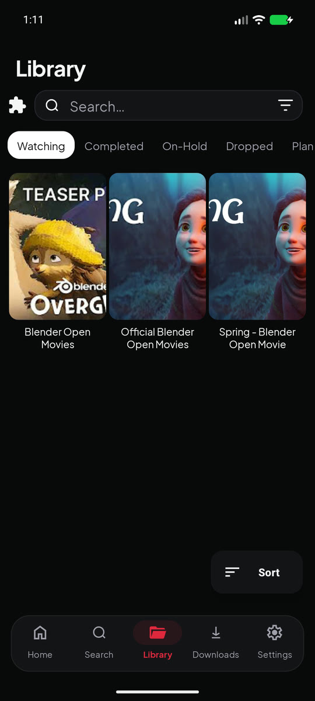
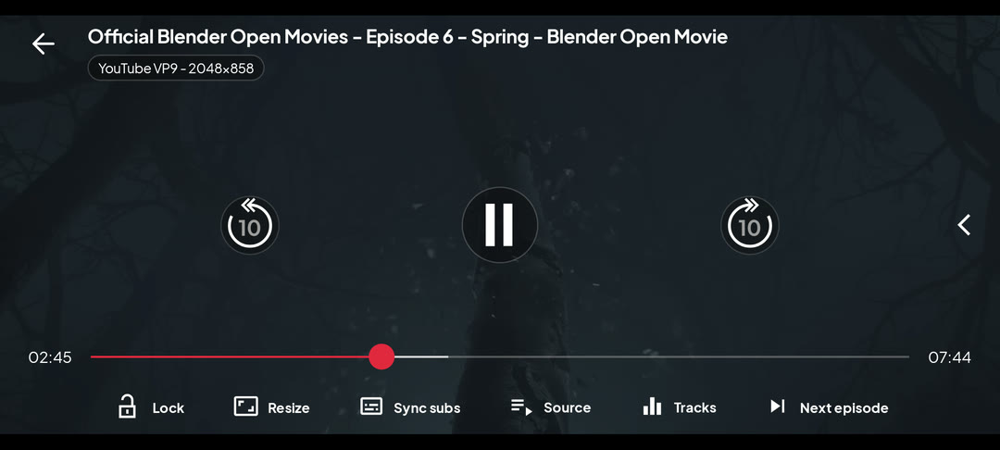
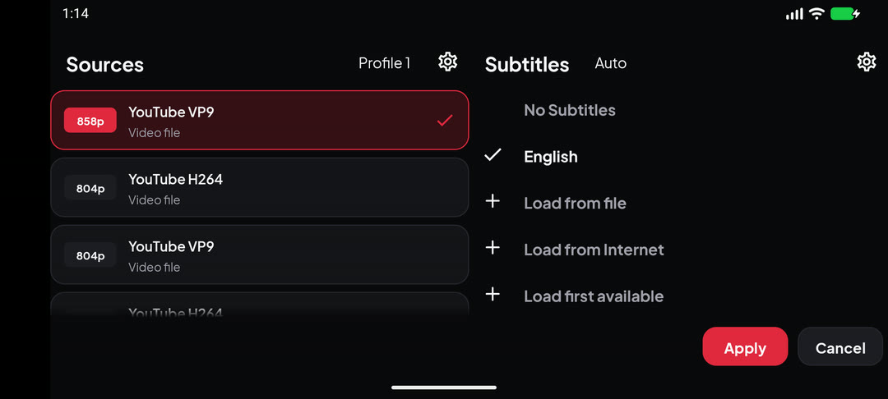

# CloudStream Skia

A redesigned build of [CloudStream](https://github.com/recloudstream/cloudstream), the
extension-based media app for Android phones and TV. Skia changes how the app looks and
feels on phones; everything else is CloudStream, merged from upstream every day.

> **Note:** the app does not include any video sources. You add them yourself by installing
> extensions.

**[Download the latest APK](https://github.com/rigaz29/cloudstream-skia/releases/download/pre-release/CloudStream-Skia.apk)** ·
[Release notes](https://github.com/rigaz29/cloudstream-skia/releases/tag/pre-release)

  
  
  

  
  

Screenshots show Blender Studio's open movies, released under Creative Commons, through the YouTube extension.

## Install

1. Download `CloudStream-Skia.apk` from the link above and open it. Android may ask you to
   allow installs from your browser or file manager.
2. Add extensions: open an extension repository link shared by its author, or add the
   repository URL in Settings > Extensions. The
   [CloudStream documentation](https://recloudstream.github.io/csdocs/) explains how.
3. Optional: to keep your bookmarks, history and settings, make a backup in CloudStream
   (Settings > Updates and Backup) and restore it in Skia.

Good to know:

- One APK for phones, tablets, Android TV and emulators (arm64-v8a, armeabi-v7a, x86,
  x86_64), Android 6.0 or newer.
- Skia installs next to the official CloudStream apps: it has its own package name
  (`com.lagradost.cloudstream3.skia`) and signing key. It is not an update for them.
- The app checks this repository for new versions and offers them in-app.

## What's different

Skia keeps every CloudStream feature and works with every CloudStream extension. On phones
it changes:

- **Look:** a darker base, one crimson accent, Plus Jakarta Sans as the interface font, and
  rounder cards and buttons. Other themes and accent colors from the settings still work.
- **Navigation:** a floating bottom bar with labels; the source picker sits at the top of
  Home.
- **Details page:** taller artwork with floating round buttons, a larger title, season pills
  instead of a season dialog, and episode rows with larger thumbnails.
- **Player:** the title on the left with the source and resolution in a pill, round backings
  for the center controls, and a source list that shows the quality, stream type and origin
  of every link.
- **Search and Library:** page titles, a larger search field, a line that shows how many
  sources have answered, and the library lists as pills at the top.

## Following upstream

Every day a GitHub Actions workflow merges CloudStream's `master` branch into this fork,
builds a signed APK and publishes it as the `pre-release` release. The fork's changes are kept
apart from upstream code (see [SKIA.md](SKIA.md)), so merges are normally automatic; when one
is not, the workflow opens an issue here.

## Known limitations

- Signing in to AniList, MyAnimeList, Simkl and Trakt does not work yet: these services need
  client keys that belong to the official builds.
- The redesign targets the phone layout. Android TV keeps CloudStream's layout and only picks
  up the colors and font.
- CloudStream is moving Home to a new screen. Skia's changes to Home stay small until that
  lands.

## Reporting problems

- Something that looks or behaves differently from the official app:
  [open an issue here](https://github.com/rigaz29/cloudstream-skia/issues).
- A problem that also happens in the official CloudStream app: report it
  [upstream](https://github.com/recloudstream/cloudstream/issues/new/choose).
- A problem with one site or extension: report it to that extension's author.

## Extensions

Skia runs CloudStream extensions unchanged. To write your own, see the
[extension developer guide](https://recloudstream.github.io/csdocs/devs/gettingstarted/).

Please don't create illegal extensions or use any that host copyrighted media. Neither
CloudStream nor Skia hosts any content, and extensions are not moderated or endorsed by
either project.

## Translations

The app's text comes from CloudStream and is translated on
[Weblate](https://hosted.weblate.org/engage/cloudstream/). The few texts that Skia adds are
in English for now.

## Building

See [SKIA.md](SKIA.md) for how the fork is organized. In short: JDK 17 and the Android SDK
(platform 37), then `./gradlew assemblePrereleaseDebug`.

## Credits and license

- [CloudStream](https://github.com/recloudstream/cloudstream) by its contributors: the app
  and all of its features are their work.
- [Plus Jakarta Sans](https://github.com/tokotype/PlusJakartaSans) by Tokotype, under the
  SIL Open Font License 1.1.
- Released under the GNU General Public License v3.0, like CloudStream (see [LICENSE](LICENSE)).
